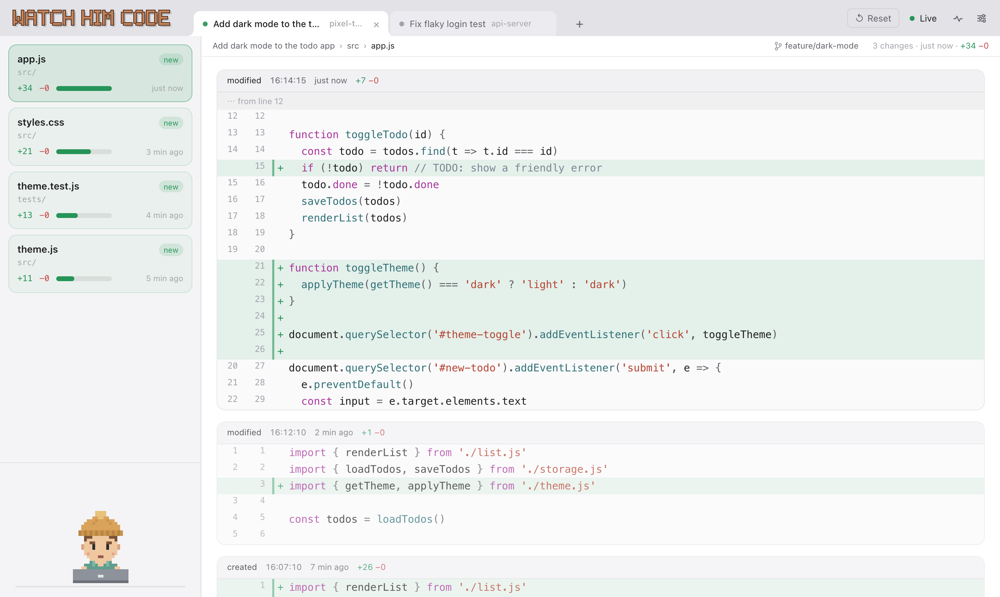
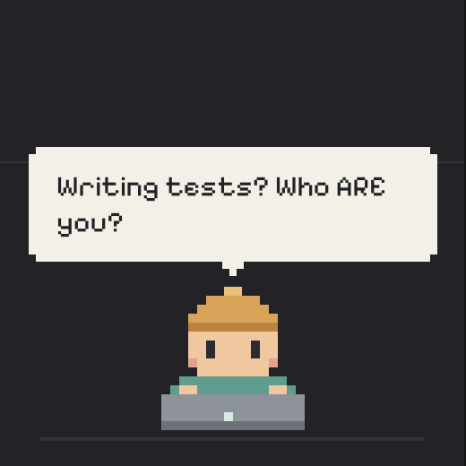

# Watch Him Code

**Your AI agent writes the code. You supervise. Professionally. From a second monitor.**

Watch Him Code is a tiny window that shows you, live, every file
[Claude Code](https://claude.com/claude-code) creates or changes – like a senior developer
looking over a junior's shoulder, except the junior types 4,000 words per minute and never
asks for a raise.

No thoughts. No token counts. No costs. No chat history. Just the code, appearing in front of
your eyes, so you can nod thoughtfully and occasionally say *"hmm"*.


---

## Why does this exist?

Because "let the agent cook" is a great philosophy until you realise you have no idea what it
put in the oven.

The existing tools were either full-blown dashboards with seventeen tabs, charts about your
charts and a settings page that needs its own settings page – or they used git as a source,
which means you only find out what happened *after* it happened. Like a security camera that
only shows you yesterday.

Watch Him Code reads Claude Code's session logs instead, so every single edit shows up the
moment it lands. It is deliberately small, deliberately quiet and deliberately has **zero
dependencies**. `npm install` is not part of this story.

## Features

- **Live, file by file.** New and modified files appear instantly. The view follows the latest
  change automatically, like a very loyal dog.
- **Two views, same powers.**
  - *Editor* – Xcode-flavoured: folder tree, the whole file, changes marked in the gutter.
    Deleted lines briefly appear struck through, then politely collapse.
  - *Cards* – file cards with growing +/− bars and a stack of diffs per file.
- **Three diff modes.** *New* (just the result), *Inline* (old and new stacked) or *Side by
  side* (old left, new right, gaps hatched like a 90s textbook).
- **Every session at once.** Running several agents? Each session gets a tab. A pulsing dot
  tells you which one is currently busy rewriting your life.
- **Git branch awareness.** Shows the branch of the repo each file lives in – including nested
  repos and submodules, so you know *which* repo it's breaking.
- **Catches shell edits too.** Agent sneaks a `sed -i` past you? Watch Him Code asks git what
  changed in the session's repos (subrepos included) and shows it anyway, marked *via shell*.
- **Status check.** The pulse icon next to the settings (or `i`) checks Node, logs, git, folder
  access and whether edits are actually visible – and opens by itself if something's off.
- **Light, dark or system.** Both are muted. Your retinas have suffered enough.
- **The Pixel Junior.** See below. He's the best part. He knows it.
- **Real apps.** A native Mac app and a Windows app, about 1 MB each. Double-click, done.
  Closing the window keeps them watching in the background (Dock / tray); quit to really stop.




## Meet the Pixel Junior



He sits in the corner, types along when code comes in, throws a little sheet of paper when a new
file is born, sweeps up crumbs when code gets deleted, falls asleep after two minutes of silence
and startles awake when work resumes. Just like a real developer.

Occasionally he comments on what he sees. Rarely, briefly, and based only on facts:

> *"+240 lines in one go. Bold."*
> *"A TODO. Future you will love that."*
> *"console.log debugging. A classic."*
> *"Writing tests? Who ARE you?"*
> *"CSS time. Good luck centering that div."*
> *"I was NOT asleep."*

Press **`d`** to make him perform his entire repertoire. Don't like him? Settings → Pixel Junior →
Off. He won't take it personally. (He will.)

<br clear="right">

## Getting started

You need **Node.js 18+**. That's it. That's the list.

### Download

Grab the ready-made apps from the **[latest release](https://github.com/stfnhdr/watch-him-code/releases/latest)**:

- **macOS** (Apple Silicon + Intel): `WatchHimCode-macOS.zip` – unzip, drag into Applications.
  The app isn't notarized by Apple, so the first launch gets blocked. Go to *System Settings →
  Privacy & Security* and click *Open Anyway*. Or, if you like terminals:
  `xattr -dr com.apple.quarantine "/Applications/Watch Him Code.app"`
- **Windows** (10/11, x64): `WatchHimCode-windows.zip` – unzip, run `WatchHimCode.exe`.
  SmartScreen will complain, see below.

Prefer to build it yourself? Read on.

### Mac

```bash
./app/macos/build.sh
```

Drag `dist/Watch Him Code.app` into Applications and double-click it. It starts its own little
server, shows everything in a native window and cleans up after itself when you quit – even if
it crashes, because we were raised right.

### Windows

```bash
./app/windows/build.sh   # works on a Mac too, needs the .NET SDK
```

Unzip `dist/WatchHimCode-windows.zip` on your Windows machine and run `WatchHimCode.exe`.
SmartScreen will warn you about an "unknown publisher". That's us. We're the unknown publisher.
Click *More info* → *Run anyway*.

### Without the apps

```bash
node server.js
```

Opens a chromeless app window via Chrome/Edge (`--app` mode) or falls back to your default
browser at `http://127.0.0.1:4777`.

## Keyboard shortcuts

| Key   | Does                                         |
| ----- | -------------------------------------------- |
| `Esc` | Back to live (follow the latest change)      |
| `v`   | Switch view: Editor ↔ Cards                  |
| `s`   | Cycle diff mode: New → Inline → Side by side |
| `t`   | Cycle theme: Light → Dark → System           |
| `d`   | Pixel Junior demo                            |

## How it works

Claude Code writes every session to `~/.claude/projects/<project>/<session>.jsonl` – both the
terminal and the desktop app. Watch Him Code:

1. watches every session that was active in the last 30 minutes,
2. reads new lines as they arrive (every 0.6 s),
3. keeps only entries where a file was created or edited (`Write`, `Edit`, `MultiEdit`, and
   `NotebookEdit` on a good day),
4. reconstructs the full file around each change and streams it to the window via
   Server-Sent Events.

It listens on `127.0.0.1` only. Nothing leaves your machine, nothing is uploaded, nothing is
"synced to the cloud for a better experience".

**Shell edits:** if the agent changes files via shell commands (`sed`, scripts, MCP tools …),
there's no diff in the log. So after every tool call (and every 8 s while a session is busy)
the server runs `git status` in the session's repos – nested subrepos included – and diffs
changed files against the last version it knew. Uncommitted work that was already there when
it started is left alone. Outside git repos, or in `.gitignore`d files, shell edits stay
invisible – the agent's last alibi.

## Options

| Variable              | Effect                                |
| --------------------- | ------------------------------------- |
| `WHC_PORT`            | Different port (default `4777`)       |
| `WHC_NO_OPEN=1`       | Don't open a window                   |
| `WHC_BROWSER=default` | Default browser instead of app window |
| `WHC_GIT=0`           | No git fallback for shell edits       |
| `CLAUDE_CONFIG_DIR`   | Read logs from there instead of `~/.claude` |

## Project layout

```
server.js               the whole backend, Node built-ins only
public/                 the UI (plain HTML, CSS, JS – no framework, no build step)
  app.js                live logic, sessions, views, diffs
  buddy.js              the Pixel Junior and his opinions
  highlight.js          a tiny home-made syntax highlighter
  logo.js               the pixel logo, letter by letter
app/macos/              Swift + WKWebView wrapper
app/windows/            C# + WebView2 wrapper (.NET Framework 4.8, built into Windows)
tools/screenshots.js    regenerates these screenshots from a fake demo project
```

## FAQ

**Can I edit code in it?**
No. You're the senior now. Seniors don't type, they *observe*.

**Does it show my prompts or the agent's thinking?**
No. Only code. What the agent was thinking stays between the agent and its context window.

**Will it show markdown files and other non-code files too?**
Yes – anything the agent writes or edits shows up. Filters are on the wishlist.

**Why "Him"?**
Because "Watch It Code" sounded like a nature documentary.

---

Built with Claude Code, watched with Watch Him Code. It's turtles all the way down.

## License

[MIT](LICENSE) – do whatever you want, just keep the notice. The software comes "as is",
which, given that it was written by an AI and supervised by a human from a second monitor,
seems only fair.

The pixel font is [Pixelify Sans](https://github.com/eifetx/Pixelify-Sans) (SIL Open Font
License, bundled in `public/fonts/` with its own license).
