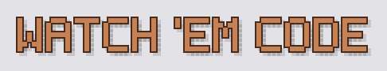
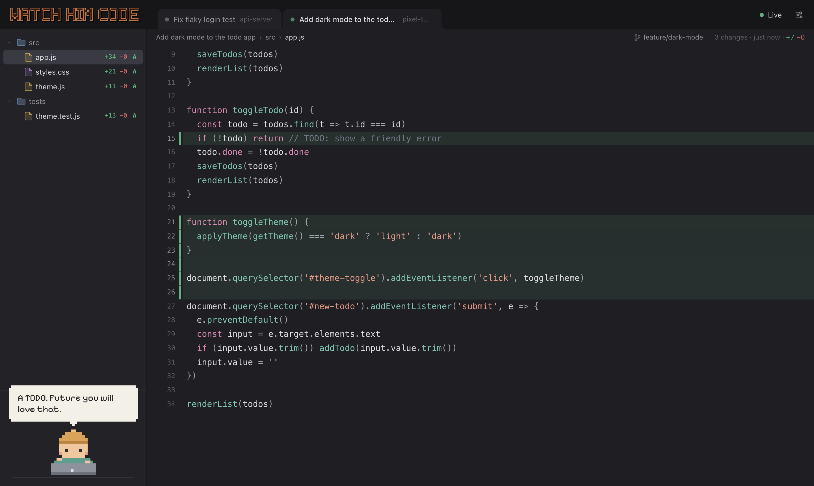
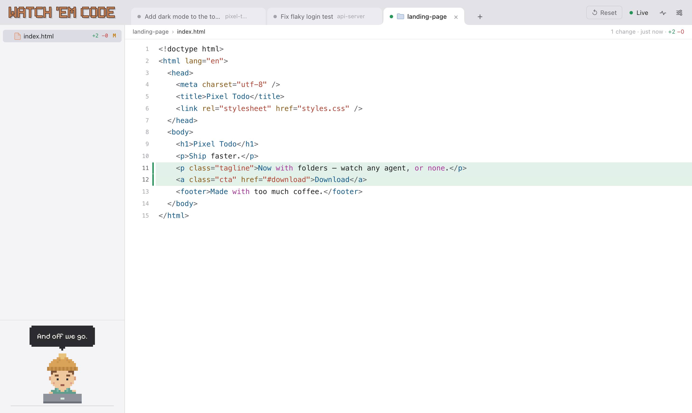
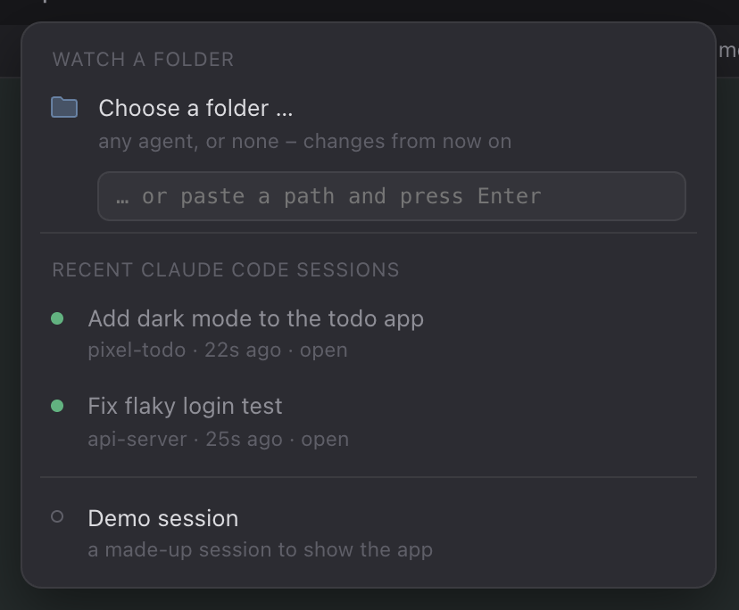
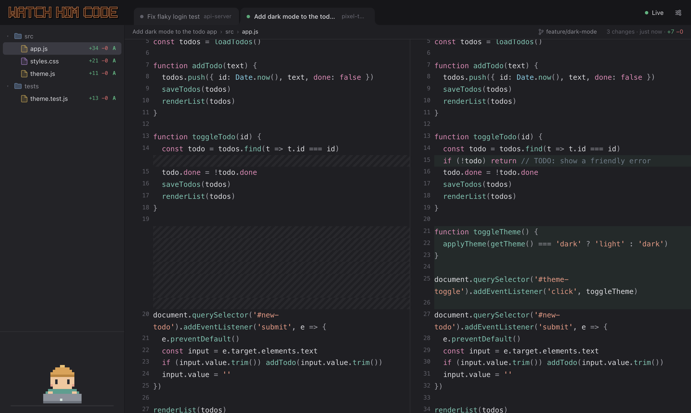
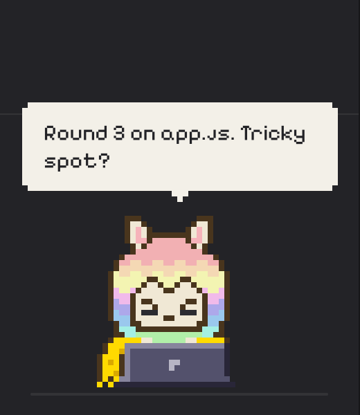
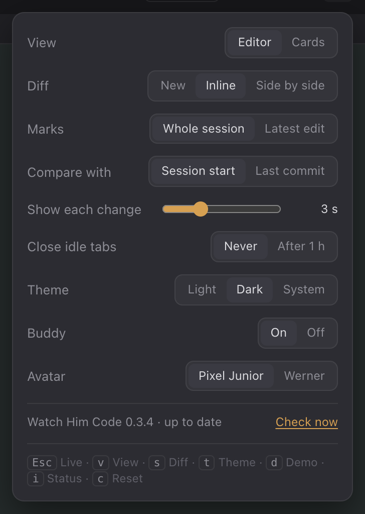

<p align="center">
  <picture>
    <source media="(prefers-color-scheme: dark)" srcset="docs/screenshots/logo-dark.png">
    
  </picture>
</p>

<p align="center"><b>Your AI agents write the code. You supervise. Professionally. From a second monitor.</b></p>

Watch 'Em Code is a tiny window that shows you, live, every file your coding agents create or
change – like a senior developer looking over a junior's shoulder, except the junior types 4,000
words per minute, never asks for a raise and occasionally there are five of them.

It follows [Claude Code](https://claude.com/claude-code) sessions automatically, and it watches
**any folder** you point it at – so Cursor, Codex, Aider, Gemini CLI, your colleague or that
script you forgot was running all show up too.

No thoughts. No token counts. No costs. No chat history. Just the code, appearing in front of
your eyes, so you can nod thoughtfully and occasionally say *"hmm"*.



---

## Why does this exist?

Because "let the agent cook" is a great philosophy until you realise you have no idea what it
put in the oven.

The existing tools were either full-blown dashboards with seventeen tabs, charts about your
charts and a settings page that needs its own settings page – or they showed you git history,
which means you only find out what happened *after* it happened. Like a security camera that
only shows you yesterday.

Watch 'Em Code shows every single edit the moment it lands. It is deliberately small,
deliberately quiet and deliberately has **zero dependencies**. `npm install` is not part of this
story.

## Two ways to watch

**Claude Code sessions – automatic.** Watch 'Em Code reads Claude Code's session logs, so every
session gets its own tab the moment it starts editing, with its title, its branch and every
single edit as the agent makes it. Nothing to set up.

**Any folder – one click.** Press **+** → *Choose a folder …* (or paste a path). From then on,
every file that changes in it shows up – no matter who or what changed it. Inside git repos, git
decides what counts (so `.gitignore` keeps `node_modules` out of your face); outside git, the
folder is remembered as it was when you started watching. Close the tab to stop watching.





## Features

### Watch

- **Live, file by file.** New and modified files appear the moment they land. The view follows
  the latest change, like a very loyal dog – and keeps each change on screen for a moment
  (*Show each change*, 0–10 s) so it doesn't jump around like a caffeinated squirrel. Files
  changed meanwhile queue up and play in order; `Esc` jumps to the newest.
- **Two views, same powers.**
  - *Editor* – Xcode-flavoured: folder tree, the whole file, changes marked in the gutter.
    Deleted lines briefly appear struck through, then politely collapse.
  - *Cards* – file cards with growing +/− bars and a stack of diffs per file.
- **Three diff modes.** *New* (just the result), *Inline* (old and new stacked) or *Side by
  side* (old left, new right, gaps hatched like a 90s textbook).
- **Catches shell edits too.** Claude sneaks a `sed -i` past you? Watch 'Em Code asks git what
  changed in the session's repos (subrepos included) and shows it anyway, marked *via shell*.

### Understand what changed

- **What really changed, like `git diff`.** Each file shows everything that changed in it as
  *one* diff – several edits combined. Tree, cards and the bar above the file show the net +/−.
  The newest edit is still the one that animates.
- **Compare with session start or last commit.** By default you see what the whole session did.
  Switch to *Last commit* and each repo compares against its latest commit – exactly like VS Code;
  commits are picked up automatically.
- **↺ Reset.** Long session, then a PR, then review comments? Click *Reset* (or press `c`) and
  the tab only shows what changes from now on. Nothing is deleted – the orange *since …* pill
  brings everything back.
- **Git branch awareness.** Shows the branch of the repo each file lives in – including nested
  repos and submodules, so you know *which* repo it's breaking.

### Many tabs

- **Every Claude session and every watched folder gets a tab.** A pulsing dot tells you which one
  is currently busy rewriting your life.
- **+ opens a folder or an older Claude session** – your 40 most recent ones, with title or first
  prompt.
- **Session tabs stay open** until you close them (or set *Close idle tabs → After 1 h*), and come
  back by themselves when that session gets busy again. Folder tabs stay until you close them –
  even across restarts.
- **Resizable file tree.** Drag its edge; double-click resets it.

### Live with it

- **The Pixel Junior – or Werner, or Clawde.** See below. They're the best part. They know it.
- **Light, dark or system.** Both are muted. Your retinas have suffered enough.
- **Status check.** The pulse icon (or `i`) checks Node, logs, git, folder access and whether
  edits are actually visible – and opens by itself if something's off.
- **Real apps.** A native Mac app (DMG) and a Windows app, about 1 MB each. Closing the window
  keeps them watching in the background (Dock / tray); quit to really stop.
- **Updates itself – when you say so.** A new release shows up as a little ↑ button (and in the
  settings). One click on *Install & restart* and the app replaces itself.
- **Demo.** Nothing running? Press `d` and a made-up session plays in its own tab – handy for
  showing the app to colleagues.




## Meet the Pixel Junior (and Werner, and Clawde)

<table><tr>
<td></td>
<td></td>
</tr></table>

The **Pixel Junior** sits in the corner, types along when code comes in, throws a little sheet of
paper when a new file is born, sweeps up crumbs when code gets deleted, falls asleep after two
minutes of silence and startles awake when work resumes. Just like a real developer.

Prefer an alpaca? *Settings → Avatar → Werner* swaps him for **Werner Sauer**, our team mascot:
rainbow wool, yellow scarf, permanently unimpressed brows – and sparks flying off the laptop while
he types. Same desk, same opinions.

Or *Settings → Avatar → Clawde* for **Clawde Code**, a black-and-white tuxedo cat with yellow
eyes who looks over Claude's shoulder all day. While code comes in he goes big-eyed and bats at
the keyboard – one paw on the laptop, the other in the air, fur flying. When the burst is over he
does a little hop with a happy squint, then sits back down as if nothing happened.

Occasionally they comment on what they see. Rarely, briefly, and based only on facts:

> *"+240 lines in one go. Bold."*
> *"A TODO. Future you will love that."*
> *"console.log debugging. A classic."*
> *"Writing tests? Who ARE you?"*
> *"CSS time. Good luck centering that div."*
> *"I was NOT asleep."*

Press **`d`** for the demo to see the whole repertoire. Don't want company? *Settings → Buddy →
Off*. They won't take it personally. (They will.)

## Settings



| | |
|---|---|
| **View** | Editor or Cards |
| **Diff** | New, Inline or Side by side |
| **Marks** | *Whole session* – everything that changed in a file; *Latest edit* – only the newest edit |
| **Compare with** | *Session start* or *Last commit* (like VS Code) |
| **Show each change** | how long a change stays on screen before the next one, 0–10 s |
| **Close idle tabs** | *Never* or *After 1 h* without activity |
| **Theme** | Light, Dark or System |
| **Buddy** / **Avatar** | Pixel Junior, Werner or Clawde, or nobody |

At the bottom: the version you're running, with **Check now** for updates.

<br clear="right">

## Getting started

You need **Node.js 18+** (20+ on Linux for watching folders). That's it. That's the list.

### Download

Grab the ready-made apps from the **[latest release](https://github.com/stfnhdr/watch-em-code/releases/latest)**:

- **macOS** (Apple Silicon + Intel): `WatchEmCode-macOS.dmg` – open it, drag the app onto
  *Applications*, start it from there. (Starting it straight out of Downloads makes macOS run a
  temporary copy that can crash once you move the app.)
  The app isn't notarized by Apple, so the first launch gets blocked. Go to *System Settings →
  Privacy & Security* and click *Open Anyway*. Or, if you like terminals:
  `xattr -dr com.apple.quarantine "/Applications/Watch 'Em Code.app"`
- **Windows** (10/11, x64): `WatchEmCode-windows.zip` – unzip, run `WatchEmCode.exe`.
  SmartScreen will complain, see below.

Coming from *Watch Him Code*? Just update from inside the app – settings, window size and
watched sessions carry over, and the Mac app renames itself on its first start.

Prefer to build it yourself? Read on.

### Mac

```bash
./app/macos/build.sh
```

Drag `dist/Watch 'Em Code.app` into Applications and double-click it. It starts its own little
server, shows everything in a native window and cleans up after itself when you quit – even if
it crashes, because we were raised right.

### Windows

```bash
./app/windows/build.sh   # works on a Mac too, needs the .NET SDK
```

Unzip `dist/WatchEmCode-windows.zip` on your Windows machine and run `WatchEmCode.exe`.
SmartScreen will warn you about an "unknown publisher". That's us. We're the unknown publisher.
Click *More info* → *Run anyway*.

### Without the apps

```bash
node server.js
```

Opens a chromeless app window via Chrome/Edge (`--app` mode) or falls back to your default
browser at `http://127.0.0.1:4777`.

## Keyboard shortcuts

| Key   | Does                                         |
| ----- | -------------------------------------------- |
| `Esc` | Back to live (follow the latest change)      |
| `v`   | Switch view: Editor ↔ Cards                  |
| `↑` `↓` | Previous / next file (after clicking into the tree or cards) |
| `s`   | Cycle diff mode: New → Inline → Side by side |
| `t`   | Cycle theme: Light → Dark → System           |
| `d`   | Demo: plays a made-up session in its own tab |
| `i`   | Status: does everything work?                |
| `c`   | Reset: hide this tab's earlier changes, show only new ones |

## How it works

**Claude Code sessions.** Claude Code writes every session to
`~/.claude/projects/<project>/<session>.jsonl` – both the terminal and the desktop app.
Watch 'Em Code:

1. watches every session that was active in the last hour (plus the tabs you keep open),
2. reads new lines as they arrive (every 0.6 s),
3. picks out every file the agent created or edited (`Write`, `Edit`, `MultiEdit`,
   `NotebookEdit`) – and asks git about everything else (see *Shell edits* below),
4. per file, compares the content at the session start (or the last commit, or your reset)
   with what's on disk now, and streams it all to the window via Server-Sent Events.

**Watched folders.** The folder is watched with the operating system's file events (`fs.watch`).
Inside git repos, a change makes it ask `git status` what changed and diff that against the last
version it knew – `.gitignore` applies, and a few usual suspects (`.DS_Store`, `node_modules`,
`dist`, editor temp files …) are left out on top. Outside git, every text file is remembered when
watching starts (up to 5,000 files), and changes are diffed against that. Like with sessions,
only what changes *after* you start watching shows up. The list of folders is kept in
`~/.watch-em-code/folders.json`.

It listens on `127.0.0.1` only. Your code, logs and sessions never leave your machine, nothing
is uploaded, nothing is "synced to the cloud for a better experience". Endpoints that change
something only accept requests from its own page.

The one thing that does go out: every 6 hours it asks GitHub's public API for the latest release
(no login, no data about you or your code – GitHub just sees your IP, like any download). Turn
it off with `WHC_UPDATE_CHECK=0`.

**Updates:** if there's a newer release, a ↑ button appears in the title bar. In the Mac and
Windows app, *Install & restart* downloads the release ZIP from this repository's GitHub
releases, swaps the app and restarts it – only when you click. Running it with
`node server.js`? Then you get a link to the release (or just `git pull`).
On a Mac, macOS may ask again for folder access after an update – the app is only signed
locally, so every new version looks like a new app to it.

**Shell edits (Claude sessions):** if the agent changes files via shell commands (`sed`, scripts,
MCP tools …), there's no diff in the log. So after every tool call (and every 8 s while a session
is busy) the server runs `git status` in the session's repos – nested subrepos included – and
diffs changed files against the last version it knew. Uncommitted work that was already there
when it started is left alone. Outside git repos, or in `.gitignore`d files, shell edits stay
invisible in session tabs – the agent's last alibi. (Watch the folder instead and they show up.)

**Optional – finer diffs:** shell edits show up as one change per command, while Claude's own
file tools give you every single edit as it happens. If you'd rather watch it that way, add
this line to your `~/.claude/CLAUDE.md` (it's a gentle hint, nothing gets blocked):

```markdown
Prefer the Edit/Write tools over shell commands (sed, echo >, heredocs, scripts) for changing files.
```

## Options

| Variable              | Effect                                |
| --------------------- | ------------------------------------- |
| `WHC_PORT`            | Different port (default `4777`)       |
| `WHC_NO_OPEN=1`       | Don't open a window                   |
| `WHC_BROWSER=default` | Default browser instead of app window |
| `WHC_GIT=0`           | No git fallback for shell edits       |
| `CLAUDE_CONFIG_DIR`   | Read logs from there instead of `~/.claude` |
| `WHC_UPDATE_CHECK=0`  | Don't check GitHub for new versions   |

(`WHC` is what this project was called before it learned to watch more than one agent. The
variables keep their names so nothing breaks.)

**Releasing:** bump the version in `server/config.js` (`VERSION`), `app/macos/Info.plist` and
`app/windows/WatchEmCode.csproj`, run both build scripts and attach `WatchEmCode-macOS.dmg`,
`WatchEmCode-macOS.zip` and `WatchEmCode-windows.zip` from `dist/` to a GitHub release tagged
`vX.Y.Z`. The DMG is for people, the two ZIPs are what the updater downloads – they must end in
`macOS.zip` and `windows.zip`.

## Project layout

```
server.js               entry point (node server.js)
server/                 the backend, Node built-ins only – one module per job
  claude.js             source: Claude Code session logs
  folders.js            source: watched folders (fs.watch)
  shellwatch.js         git fallback for shell edits in Claude sessions
  sessions.js           tabs and their changes, whatever the source
  git.js, repos.js      asking git, branches
  diff.js, text.js      line diffs, text helpers
  http.js, bus.js       the server, endpoints, live connection
  update.js, status.js  update check, status check
  window.js, main.js    opening a window, start-up
public/                 the UI (plain HTML, CSS, JS – no framework, no build step)
  app.js                live logic, tabs, views, diffs
  buddy.js              the Pixel Junior, Werner, Clawde and their opinions
  demo.js               the made-up demo session (key d)
  highlight.js          a tiny home-made syntax highlighter
  logo.js               the pixel logo, letter by letter
app/macos/              Swift + WKWebView wrapper
app/windows/            C# + WebView2 wrapper (.NET Framework 4.8, built into Windows)
tools/screenshots.js    regenerates these screenshots from a fake demo project
```

## FAQ

**Can I edit code in it?**
No. You're the senior now. Seniors don't type, they *observe*.

**Does it show my prompts or the agent's thinking?**
No. Only code. What the agent was thinking stays between the agent and its context window.

**Does it work with agents other than Claude Code?**
Yes – watch their project folder (**+** → *Choose a folder …*). You get every file change, from
anyone. What you don't get for them: automatic tabs per session and session titles, because
those come from Claude Code's logs.

**Will it show markdown files and other non-code files too?**
Yes – anything that gets written shows up. In watched folders, `.gitignore` and a short list of
usual suspects keep the worst noise out.

**Why "'Em"?**
It used to be *Watch Him Code*. Then it learned to watch every agent at once – and several at a
time. "Them" was more accurate. "Watch It Code" sounded like a nature documentary.

---

Built with Claude Code, watched with Watch 'Em Code. It's turtles all the way down.

## License

[MIT](LICENSE) – do whatever you want, just keep the notice. The software comes "as is",
which, given that it was written by an AI and supervised by a human from a second monitor,
seems only fair.

The pixel font is [Pixelify Sans](https://github.com/eifetx/Pixelify-Sans) (SIL Open Font
License, bundled in `public/fonts/` with its own license).
